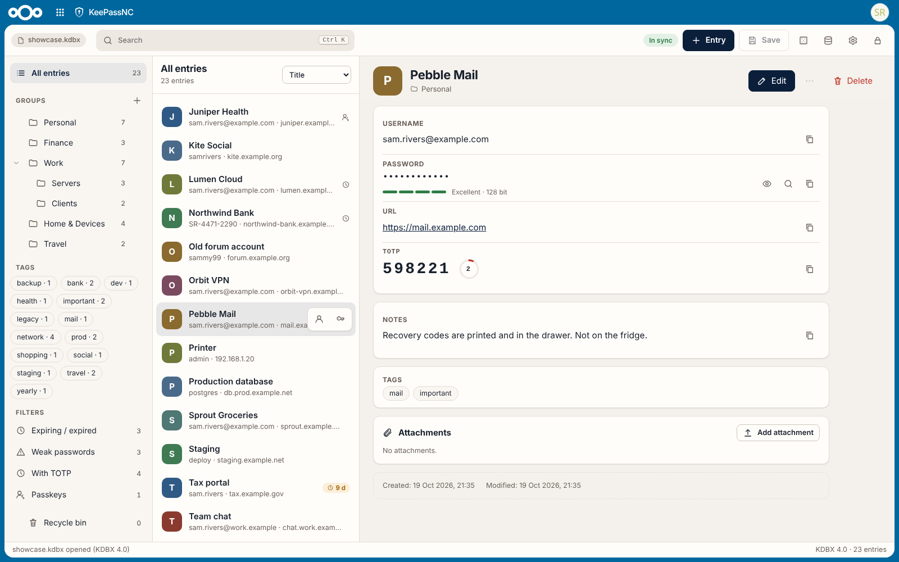
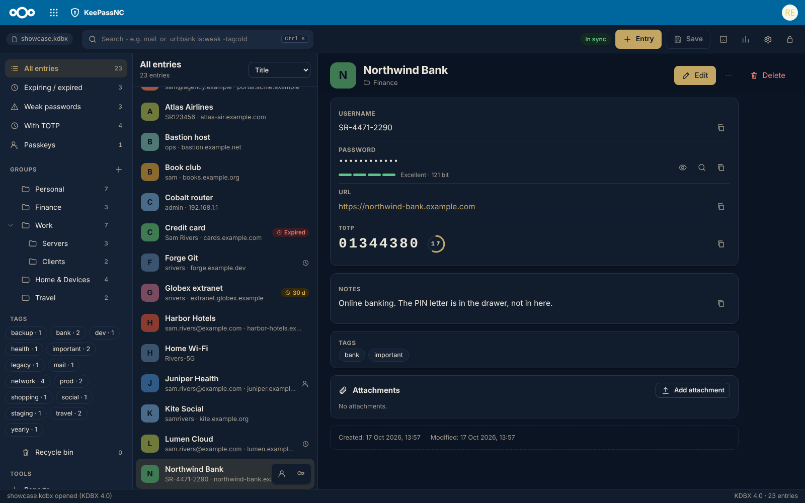
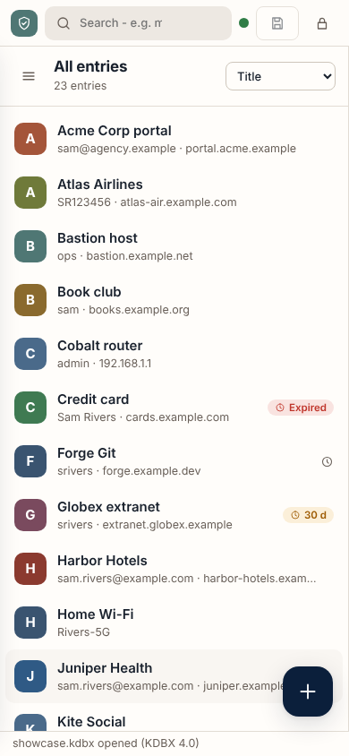
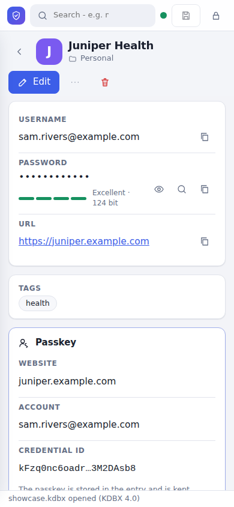

# KeePassNC
### Your KeePass passwords, right in Nextcloud.

Click your `.kdbx` file in Files, type your master password, done.

It's still a plain KeePass file, so **KeePassXC, KeePassDX and Strongbox keep working on the very same file**.
No lock-in, no special format, no drama.

  
  
  

## Why you can relax

- **Decrypted only in your browser.** Your master password and your passwords never leave it. The server only ever stores the
  encrypted file.
- **Careful saving.** A backup copy is made before every save. If two devices change the file at once, both changes are kept.
- **Works offline.** Turn on the encrypted offline copy and your passwords stay usable even when the server or network is down.
- **Phone or big screen.** Three panes on a desktop, one on a phone. Light and dark, English, German and Chinese.

## Highlights

- **Find things fast:** search like in KeePassXC and a command palette (`Ctrl+K`).
- **Codes and passkeys:** TOTP codes right next to the password, and passkeys saved by KeePassXC stay intact.
- **Better passwords:** a generator for passphrases and passwords, plus a health report for weak, reused and expired ones.
- **Moving house:** import from KeePassXC, Bitwarden, Nextcloud Passwords, Passman, 1Password, LastPass or your browser, and export to CSV.
- **Feels at home:** follows your Nextcloud color and your light or dark choice.

That's the short list. [Everything else](docs/FEATURES.md) (search tricks, shortcuts, database settings, shared files and more)
lives on its own page.

## Install

You need Nextcloud 34 or newer. KeePassNC is in the [Nextcloud App Store](https://apps.nextcloud.com/apps/keepassnc), so the
easy way is: **Apps** → search for *KeePassNC* → **Download and enable**. Or on the command line:
`sudo -u www-data php occ app:install keepassnc`

Manual install

1. Download `keepassnc-<version>.tar.gz` from the [latest release](https://github.com/StudioCuda/KeePassNC/releases/latest).
2. Unpack it into your Nextcloud's `custom_apps/` folder (or `apps/`) and make sure the web server user owns the files.
3. Enable it: `sudo -u www-data php occ app:enable keepassnc`

Then click a `.kdbx` file in Files. No database yet? **+ New** → **KeePass database** in Files makes one.

## Security

All decryption happens in your browser, and the app loads nothing from other servers. There hasn't been an independent audit
yet, so keep your usual KeePassXC copy around for now. Found a problem? Please report it privately, see [`SECURITY.md`](SECURITY.md).
That page also lists what's known and what hasn't been tested yet.

## Why this exists

KeeWeb, the KeePass app many people used inside Nextcloud, stopped getting updates. KeePassNC picks up where it left off,
with the same idea: your passwords stay in a normal KeePass file on your own server, and you open them in the browser.

What it doesn't do: fill in passwords on websites, or create new passkeys for websites. Both need a browser extension,
which is a different project. Databases locked with a hardware key (YubiKey challenge-response in KeePassXC) are left out
on purpose: browsers can't talk to the key that way.

## Contributing

Bug reports, odd KDBX files and patches are welcome.
Building from source, running the tests and the standalone page (without Nextcloud) are described in [`CONTRIBUTING.md`](CONTRIBUTING.md).
Hosting the standalone page or the generator-only page yourself: [`docs/HOSTING.md`](docs/HOSTING.md).

Not a coder? KeePassNC is free and stays that way. If it saves you some nerves, you're welcome to
[sponsor the project on GitHub](https://github.com/sponsors/StudioCuda). Totally optional, a bug report helps just as much.

Made with AI help: KeePassNC is built with [Claude Code](https://claude.com/claude-code), and the commits say so. Every change
runs through tests against KeePassXC, three browsers and real Nextcloud installs. That's a safety net, not an audit, so
[`SECURITY.md`](SECURITY.md) still asks you to keep a KeePassXC copy around.

## License and credits

AGPL-3.0-or-later. [kdbxweb](https://github.com/keeweb/kdbxweb) (MIT) does the KDBX heavy lifting, [jsQR](https://github.com/cozmo/jsQR)
(Apache-2.0) reads QR codes. The passphrase word lists are the [EFF Large Wordlist](https://www.eff.org/deeplinks/2016/07/new-wordlists-random-passphrases)
(© Electronic Frontier Foundation, CC BY 3.0 US) and [de-7776](https://github.com/dys2p/wordlists-de) by dys2p (CC0).
Behaviour is inspired by KeePassXC (GPL), but no KeePassXC code was copied. The Nextcloud side owes a nod to jhass/nextcloud-keeweb.
