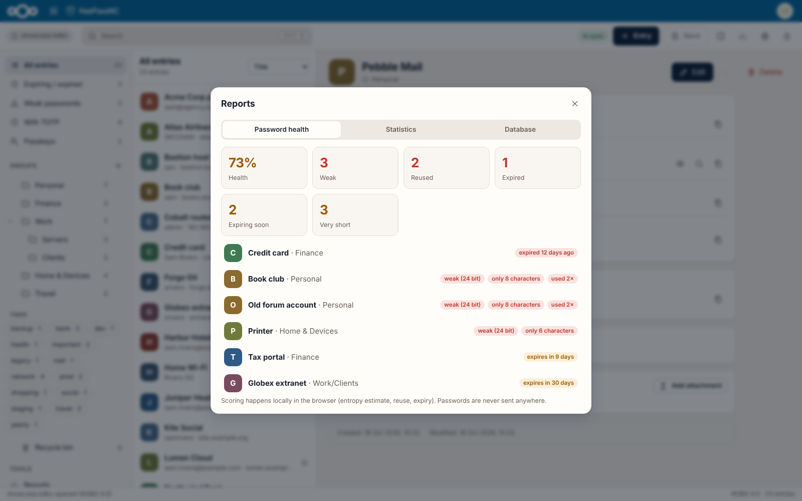
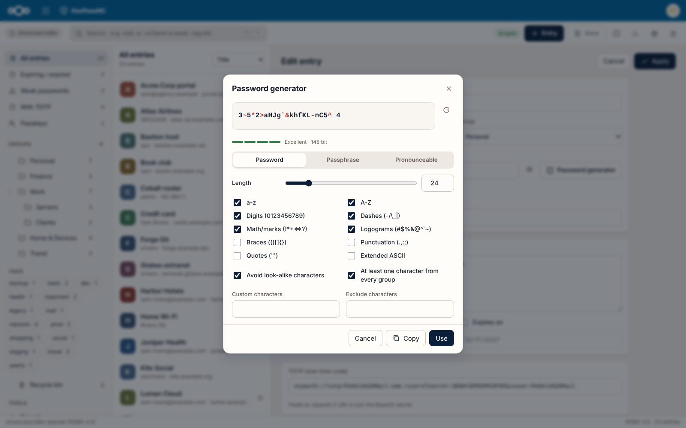

# KeePassNC
### Your KeePass passwords, right in Nextcloud.

Click your `.kdbx` file in Files, type your master password, done.

It's still a plain KeePass file, so **KeePassXC, KeePassDX and Strongbox keep working on the very same file**. No lock-in, no
special format, no drama.

  
  
  

## Why you can relax

- **Decrypted only in your browser.** Your master password and your passwords never leave it. The server only ever stores the
  encrypted file.
- **Careful saving.** A backup copy is made before every save. If two devices change the file at once, both changes are kept.
- **Works offline.** Turn on the encrypted offline copy and your passwords stay usable even when the server or network is down.
  Changes sync back later.
- **Phone or big screen.** Three panes on a desktop, one on a phone. Light and dark, English and German.

## What it can do

- **Find things fast:** search like in KeePassXC (`user:`, `tag:`, `is:weak`, `has:totp` …) and a command palette (`Ctrl+K`).
- **Stay organised:** groups with drag and drop, tags, expiry dates, attachments, recycle bin and full entry history.
- **Two-factor codes:** TOTP codes right next to the password, Steam Guard included.
- **Passkeys:** passkeys saved by KeePassXC are shown and kept intact.
- **Better passwords:** a generator for passwords and passphrases, and a health report that finds weak, reused and expired ones.
- **Shared files:** databases someone shared with you open fine; read-only shares say so.
- **Key file, remembered:** if you use a key file, KeePassNC can remember it on your device, protected by a secret on your
  server. Optional, and off by default. [How it works](docs/KEYFILE-MEMORY.md).

  
  

Keyboard shortcuts

`Ctrl+K` palette, `Ctrl+F` search, `Ctrl+N` new entry, `Ctrl+S` save, `Ctrl+L` lock, `Ctrl+B` copy user name,
`Ctrl+C` copy password, `Ctrl+Shift+U` open URL, `Del` delete.

## Install

You need Nextcloud 34 or newer. KeePassNC isn't in the Nextcloud App Store yet, so for now it's a manual install:

1. Download `keepassnc-<version>-unsigned.tar.gz` from the [latest release](https://github.com/StudioCuda/KeePassNC/releases/latest).
2. Unpack it into your Nextcloud's `custom_apps/` folder (or `apps/`) and make sure the web server user owns the files.
3. Enable it: `sudo -u www-data php occ app:enable keepassnc`

Then click a `.kdbx` file in Files.

## Security

All decryption happens in your browser, and the app loads nothing from other servers. There hasn't been an independent audit
yet, so keep your usual KeePassXC copy around for now. Found a problem? Please report it privately, see [`SECURITY.md`](SECURITY.md).
That page also lists what's known and what hasn't been tested yet.

## Why this exists

KeeWeb, the KeePass app many people used inside Nextcloud, stopped getting updates. KeePassNC picks up where it left off, with
the same idea: your passwords stay in a normal KeePass file on your own server, and you open them in the browser.

What it doesn't do: fill in passwords on websites, or create new passkeys for websites. Both need a browser extension, which
is a different project.

## Contributing

Bug reports, odd KDBX files and patches are welcome. Building from source, running the tests and the standalone page (without
Nextcloud) are described in [`CONTRIBUTING.md`](CONTRIBUTING.md).

## License and credits

AGPL-3.0-or-later. [kdbxweb](https://github.com/keeweb/kdbxweb) (MIT) does the KDBX heavy lifting. Behaviour is inspired by
KeePassXC (GPL), but no KeePassXC code was copied. The Nextcloud side owes a nod to jhass/nextcloud-keeweb.
