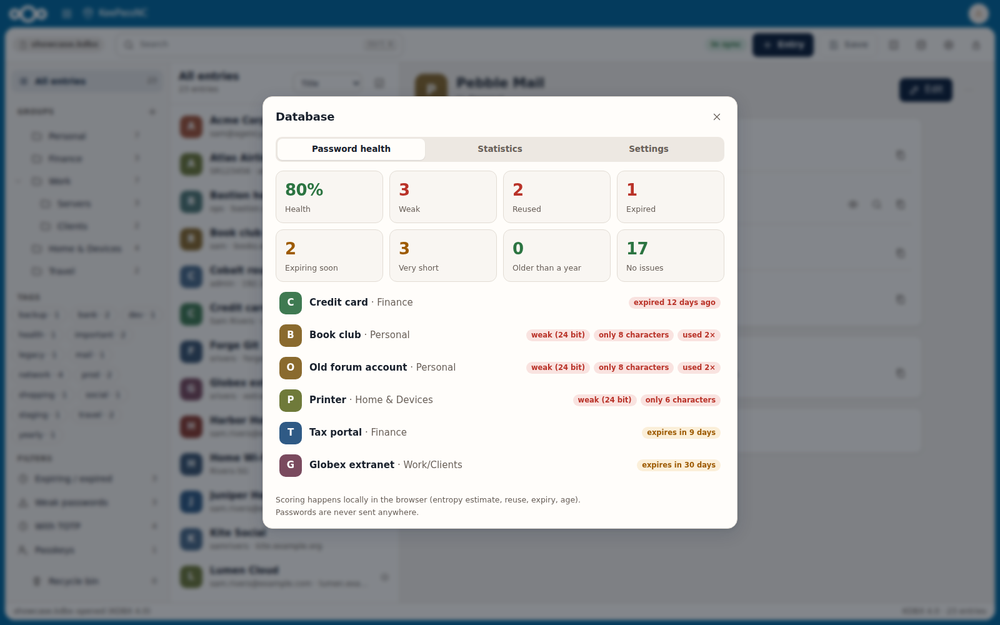
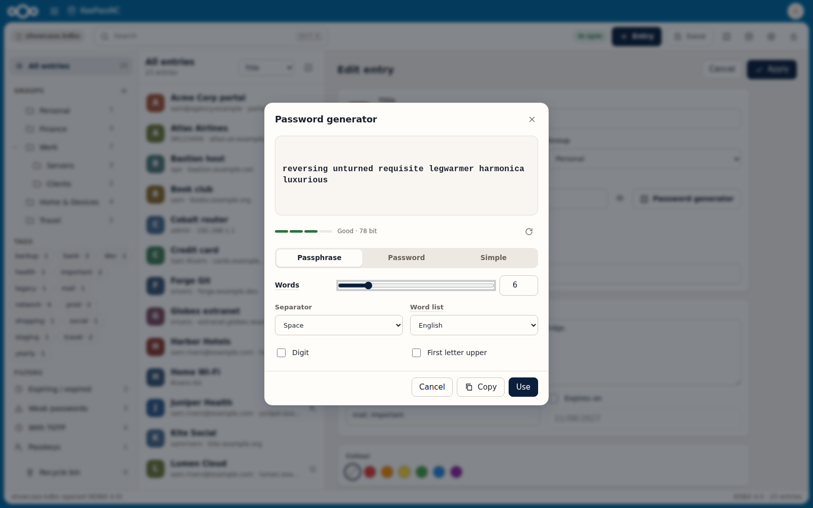

# Everything KeePassNC can do

The short tour is in the [README](../README.md). This is the long version, for when you want to know whether your favourite KeePass trick works here too (it probably does).

  
  

## Finding things

- **Search like in KeePassXC:** `user:`, `tag:`, `is:weak`, `has:totp` and friends. Plain words work too. See [Search syntax](#search-syntax) below.
- **Command palette:** press `Ctrl+K` and type what you want to do.

## Keeping things tidy

- Groups with drag and drop.
- Icons: KeePass's own, or your pictures.
- Colors, tags and expiry dates.
- Attachments. Pictures and text files get a preview. Text files (UTF-8, up to 1 MiB) can be edited in place; the old version stays in the entry's history, and BOM and line endings stay as they were. A file that mixes line endings is saved with the most common one (a tie goes to LF).
- Recycle bin and the full history of every entry, so an unlucky edit is never final.
- An edit doesn't get lost on the way: leaving it before "Apply" (another entry, "New", the palette, `Esc`, closing the tab) asks first. "Apply" without a change leaves the entry and its history alone, and field names keep their exact spelling, spaces included.

## Passwords and codes

- **Two-factor codes:** TOTP codes sit right next to the password, Steam Guard included. Setting one up? Pick a screenshot of the QR code, no typing needed.
- **Wherever your app put the TOTP:** KeePassXC's `otp` field (an `otpauth://` link, the KeeOtp plugin's `key=…` or just the secret), the older `TOTP Seed` and `TOTP Settings`, or KeePass 2's own `TimeOtp-*` fields with the secret as text, hex, Base32 or Base64. If an entry has more than one, `otp` wins, then `TOTP Seed`, then `TimeOtp-*`. Editing the entry leaves them as they are; a TOTP you change in KeePassNC goes into `otp` and the older fields go (the entry's history keeps them), so KeePassXC and KeePass 2 don't keep making codes from the old secret. Settings that can't make a code say so instead of showing one.
- **Passkeys:** passkeys saved by KeePassXC are shown and kept intact.
- **Generator:** passphrases (English or German), classic passwords, and simple ones you can type with a TV remote.
- **Health report:** finds weak, reused and expired passwords.

## Speaking fluent KeePass

- Placeholders like `{S:Host}` or `{URL:HOST}`, and `{REF:…}` references.
- Twofish, and databases locked with a key file alone.
- **Database settings:** name, recycle bin, history, encryption and key derivation. KeePassNC suggests values your browser can handle, and does a test run before it changes anything.
- **New master password or key file:** change both right in the app. A new key file only counts once you've shown that you saved it. Backup copies (`.bak`) still open with the old credentials, so the dialog can delete them. On Nextcloud, file versions and the trash bin keep old states too; clean those up in Files (see [SECURITY.md](../SECURITY.md)).
- **Key file, remembered:** if you use a key file, KeePassNC can remember it on your device, protected by a secret on your server. Optional, and off by default. [How it works](KEYFILE-MEMORY.md).

## Moving in (and out)

- Import CSV exports from KeePassXC, Bitwarden, 1Password, LastPass, Proton Pass, Chrome or Firefox. Commas, semicolons or tabs, UTF-8 or the Windows encoding Excel likes to use: a file that took a detour through a spreadsheet still comes in right.
- Coming from Nextcloud Passwords, Passman or Bitwarden? Import their JSON export (Passwords: "Backup or export" → "Database backup"). Folders, tags and extra fields come along, Passman's files too, and a Bitwarden SSH key arrives as a key file attachment that KeePassXC's SSH agent can load.
- Export to CSV the way KeePassXC does it.

## Playing nicely with Nextcloud

- **Shared files:** databases someone shared with you open fine. Read-only shares say so.
- **Feels at home:** picks up your instance's color and your light or dark choice, and keeps the Nextcloud header with the app menu on top. Search, notifications and the contacts menu sit this one out, [here's why](../SECURITY.md#model-in-short). The color, not the background image: Nextcloud has no public way to hand that one over.
- **Careful saving:** before the first save of a session, a backup copy of the file goes next to it, and another one before every merge. If two devices change the file at once, both changes are kept, even what you're typing into an entry at that moment. Got a "conflicted copy" from the Nextcloud desktop app anyway? Merge it back in from the "Database" dialog. If the server can't take the file (full, locked, or the file was moved or deleted), a banner says why and your changes stay put: save a copy, or put the file back where it was. Closing the tab while changes aren't stored anywhere yet asks first.
- **Works offline:** turn on the encrypted offline copy and your passwords stay usable when the server or network is down. Changes sync back later, also when the same database is open in two tabs. A server that stops answering counts as down after a minute (big files on slow lines get longer).
- **Phone or big screen:** three panes on a desktop, one on a phone. Light and dark, English, German and Chinese.

## Search syntax

Words separated by spaces must all match. Plain words look in title, user name, URL, notes and tags.

- **Fields:** `title:`, `user:`, `url:`, `notes:`, `pass:`, `tag:`, `group:` (with a `/` it matches the path), `attr:` (field names), `att:` (attachment names), `uuid:`. The start of a field name is enough.
- **Custom fields:** `_Name:` looks in the custom field *Name*, like `_PIN2:1234` or `_KP2A_URL_1:example`. The whole name, case doesn't matter. Names with spaces or colons go in quotes: `_"Security Question":blue`.
- **Filters:** `is:weak`, `is:expired`, `is:expired-30` (expired or expiring within 30 days), `has:totp`, `has:passkey`, `has:attachment`, `has:tags`, `has:url`, `has:notes`, `has:history`.
- **Modifiers:** `-` or `!` excludes, `+` matches the whole field exactly (case included, no wildcards), `*` turns the rest into a regular expression, like `*url:\.de$` (ignores case unless you add `+`). A regular expression that doesn't work matches nothing, and the list tells you.
- **Wildcards:** `*` stands for any run of characters, `?` for exactly one (neither reaches past the end of a line), `|` means or. They ignore case and match anywhere in the field. `"Quotes"` for values with spaces.

Example: `url:bank is:weak -tag:old`

## Locking

The page locks after the idle time you choose (and, if you like, when the tab has been hidden for a minute). With changes that can't be saved right then, the unlock screen takes over instead and keeps them in memory: unlock it with the master password (and key file) to carry on, and it offers to save. An entry you were still editing counts too: after unlocking the editor is back with what you typed. Locking by hand with such an edit open asks first, and "Keep editing" keeps it. `SECURITY.md` says what that means for security. A real lock overwrites the key file and the password hashes of the open database with zeros, as soon as the last save is through.

## Clipboard

- Copied user names, passwords and codes leave the clipboard again after the time you pick in the settings, and when the database locks.
- Browsers only let a page write the clipboard while you're using it: Chrome and Edge while the tab has the focus, Firefox and Safari within five seconds of a click or key press in it. So when the time runs out while you're pasting somewhere else (in Firefox and Safari, also when you just haven't touched the tab for a bit), the status line says the password is still on the clipboard, and your next click or key press in the tab clears it.
- Copied something else in the meantime? It stays wherever KeePassNC can tell: a paste into KeePassNC shows what's on the clipboard (that's why a click into a text field, a right click or `Ctrl+V` doesn't clear yet), and Chrome and Edge look first if the site may read the clipboard (a site setting; KeePassNC never asks for it). Where it can't tell, it clears anyway: a password left behind is worse than copying something again.
- Close the tab before that, and the password stays on the clipboard. A page can't do anything once it's gone.

## Keyboard shortcuts

`Ctrl+K` palette, `Ctrl+F` search, `Ctrl+N` new entry, `Ctrl+S` save, `Ctrl+L` lock, `Ctrl+B` copy user name, `Ctrl+C` copy password, `Ctrl+Shift+U` open URL, `Del` delete.
